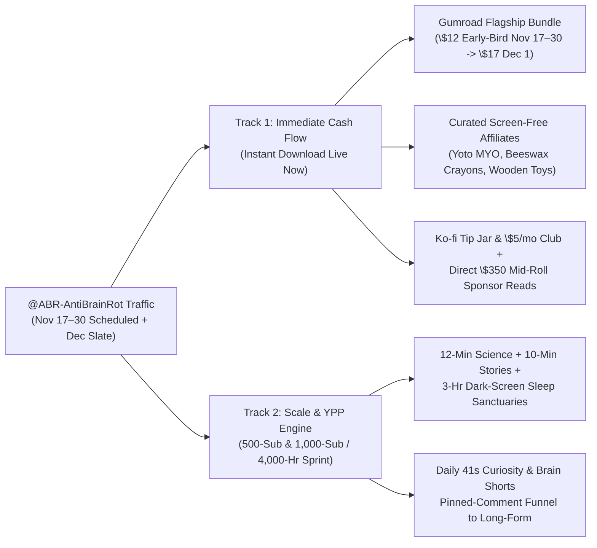

# @ABR-AntiBrainRot — December 2026 Dual-Track Monetization & Launch Blueprint

> [!IMPORTANT]
> **Baseline Calibration & Non-Negotiable Audio Law:**
> - **Starting Baseline (Nov 16, 2026):** `104+` subscribers, `10,292+` views, `27` Long-Form + `68` Shorts published/scheduled in [ABR_Anti_Brain_Rot_Index.md](file:///home/antigravity/awkandari-source/ABR_Anti_Brain_Rot/ABR_Anti_Brain_Rot_Index.md), **Pre-YPP / Pre-AdSense**.
> - **Strict Zero-Music Standard:** `0%` background music, lo-fi beats, piano, guitar, ambient synth pads, drones, chimes, or musical intros/outros across every video and paid audio track. All assets enforce **Layer 1 Human Voice** (`100–115 WPM`, `-14.0 LUFS`, `2.0s–3.5s` pauses) + **Layer 2 Organic Nature Foley** (`highpass=70Hz, lowpass=920Hz`, `-43.5 dB` mean, `5:1` sidechain ducking for `>= +30.0 dB` voice separation).

---

## Executive Architecture: Two Parallel Revenue & Scale Tracks



### Realistic Nov 17 – Dec 31 Cash-Flow Math (Pre-AdSense Baseline)
Even on lean early-stage parent traffic (`15,000–35,000` targeted views across late November + December), parent conversion on low-ticket bedtime relief outperforms general entertainment by `4x–8x`:
- **Gumroad Flagship Digital Bundle (\$12 Founding Parent Early-Bird Nov 17–30 $\rightarrow$ \$17 on Dec 1):** `15` early-bird sales (\$180) + `25–60` December sales (\$425–\$1,020) = **\$605 – \$1,200**
- **Gumroad Checkout Order Bump (+\$7 — [14_Day_Anti_Brain_Rot_Family_Reset_Playbook.md](file:///home/antigravity/awkandari-source/ABR_Anti_Brain_Rot/14_Day_Anti_Brain_Rot_Family_Reset_Playbook.md) Printable Intensive):** `30%` attach rate (`12–22` bumps) = **\$84 – \$154**
- **Curated Holiday Screen-Free Affiliates (Amazon Associates / Bookshop.org / Yoto Affiliate):** `25–50` Q4 gift orders (Yoto Mini, Blank MYO Cards, Stockmar Beeswax Crayons, wooden blocks, picture books) = **\$150 – \$380**
- **Ko-fi One-Time Parent Tips ("Buy Our Studio a Quiet Cup of Tea" — \$5) & \$5/mo *Quiet Woodland Club*:** `10–20` supporters = **\$50 – \$100+**
- **1 Direct Boutique Sponsor Test Integration (via [00_ABR_Official_Executive_Media_Kit_2026.md](file:///home/antigravity/awkandari-source/ABR_Anti_Brain_Rot/00_ABR_Official_Executive_Media_Kit_2026.md) at \$300–\$350 flat launch rate):** `1` closed partner = **\$300 – \$350**
- **Total Realistic Non-AdSense Revenue Target:** **\$889 – \$2,184** by December 31 while building `1,200–2,500+` watch hours toward YPP.

---

## Deliverable 1: 30-Day Launch Roadmap (Nov 16 – Dec 31, 2026)

### Immediate Action Insert: Pre-Launch Early-Bird CTA Block (Nov 17–30 Instant Download — \$12 Rising to \$17 on Dec 1)

Because your complete audio + PDF bundle ([ABR_Calm_Minds_Bedtime_Bundle_2026.zip](file:///home/antigravity/awkandari-source/ABR_Anti_Brain_Rot/December_2026_Launch_Pack/ABR_Calm_Minds_Bedtime_Bundle_2026.zip) — `65.67 MB`) and 90-second audio preview ([ABR_Ep1_90s_Sample.mp3](file:///home/antigravity/awkandari-source/ABR_Anti_Brain_Rot/December_2026_Launch_Pack/ABR_Ep1_90s_Sample.mp3) — `90.02s`, `-14.0 LUFS`) are already mastered, **your product goes live for instant download immediately**—giving parents across your **13 Long-Form** and **14 Short** uploads scheduled Nov 17–30 genuine urgency to lock in the **\$12 Founding Parent Early-Bird price** before it steps up to **\$17 on December 1**.

1. **Paste this Pre-Launch Description Block into Lines 3–6** on scheduled Long-Form videos `q9woVuJb9X0` (Nov 18), `TDP8imQZiQI` (Nov 18), `_H5X8Wmprds` (Nov 19), `brHB17d8UIA` (Nov 20), `WyiTNqSpkuY` (Nov 21), `MFM5CvWbE3I` (Nov 22), `CUGNOV29RWM` (Nov 23), `VeXumi5HL_Q` (Nov 23), `BgpIR-lvpZw` (Nov 24), `5_nnlfoIqkw` (Nov 25), `MSXcdZQ_9Ao` (Nov 26), `kWnXbaY5Dx0` (Nov 27), and `63o6DjnNOVU` (Nov 29):

```text
🌿 FOUNDING PARENT EARLY-BIRD ($12 INSTANT DOWNLOAD — RISES TO $17 ON DEC 1):
Get all 5 Screen-Free Winter Woodland Bedtime Audio Stories (MP3s ready for Airplane-Mode phones & Yoto Make-Your-Own cards — 100% Human Voice + Nature SFX, Strictly Zero Music) + our 5-Page Printable 30-Day Calm Minds Parent Reset Kit:
👉 https://chronicle60.gumroad.com/l/calm-evening-bundle
☕ Support Independent Zero-Music Children's Media on Quiet Woodland Club ($5/mo): https://chronicle60.gumroad.com/l/quiet-woodland-club
```

2. **Paste this Pre-Launch Pinned Comment Block** onto those same Nov 17–30 Long-Form & Short uploads (`QI6JTQCIjq8` through `F2ncByN-TB4`):

```text
🌿 Parents: Want peaceful bedtimes tonight with ZERO glowing screens and ZERO background music? Our new Calm Evening Sanctuary Bundle is now live for instant download—featuring 5 Screen-Free Winter Woodland Bedtime Stories (MP3s ready for Airplane Mode or blank Yoto cards + 90s free preview) and our 5-Page Printable 30-Day Calm Minds Screen Reset Guide. Lock in the $12 Founding Parent Early-Bird price through Nov 30 (rises to $17 on December 1) 👉 https://chronicle60.gumroad.com/l/calm-evening-bundle | ☕ Tip Jar & Monthly Club: https://chronicle60.gumroad.com/l/quiet-woodland-club
```

---

### Week-by-Week Execution Schedule (Nov 16 – Dec 31, 2026)

| Phase & Dates | Track 1: Immediate Cash Flow Milestones | Track 2: Channel Scale & YPP Watch-Time Milestones |
| :--- | :--- | :--- |
| **Week 1: Instant Early-Bird Live Launch**<br/>*(Nov 16 – Nov 22, 2026)* | • **Nov 16–17:** Open Gumroad + Ko-fi (\$5 Tips + \$5/mo *Quiet Woodland Club*).<br/>• **Nov 17:** Upload [ABR_Calm_Minds_Bedtime_Bundle_2026.zip](file:///home/antigravity/awkandari-source/ABR_Anti_Brain_Rot/December_2026_Launch_Pack/ABR_Calm_Minds_Bedtime_Bundle_2026.zip) (`65.67 MB`) as the instant digital download + attach [ABR_Ep1_90s_Sample.mp3](file:///home/antigravity/awkandari-source/ABR_Anti_Brain_Rot/December_2026_Launch_Pack/ABR_Ep1_90s_Sample.mp3) (`90.02s`) on the checkout page at **\$12 Founding Parent Early-Bird** (compare-at \$17).<br/>• **Nov 17–18:** Inject the `https://chronicle60.gumroad.com/l/calm-evening-bundle` / `https://chronicle60.gumroad.com/l/quiet-woodland-club` Pre-Launch Block into all scheduled Nov 17–30 descriptions & pinned comments.<br/>• **Nov 20:** Add Amazon Associates / Bookshop.org / Yoto Affiliate links for the 5 tactile gift picks. | • Verify [autonomous_scheduled_sweeper.py](file:///shared/user/.gemini/raw_video_studio/autonomous_scheduled_sweeper.py) routes Nov 17–22 releases (`TDP8imQZiQI`, `_H5X8Wmprds`, `brHB17d8UIA`, `WyiTNqSpkuY`, `MFM5CvWbE3I`) into the 4 official playlists.<br/>• Add End-Screen elements on every 10–15 min video pointing directly to the 3-Hour Sleep Sanctuary playlist (`PLO3jEEgHm_Iw`) to compound session watch hours. |
| **Week 2: Early-Bird Urgency & Sponsor Outreach**<br/>*(Nov 23 – Nov 29, 2026)* | • **Nov 24:** Configure **+\$7 Gumroad Checkout Order Bump** ([14_Day_Anti_Brain_Rot_Family_Reset_Playbook.md](file:///home/antigravity/awkandari-source/ABR_Anti_Brain_Rot/14_Day_Anti_Brain_Rot_Family_Reset_Playbook.md)).<br/>• **Nov 27–28:** Send 10 tailored sponsor emails from `/shared/user/.gemini/raw_video_studio/sponsor_outreach_kit/` (`Yoto`, `Lovevery`, `Woolino`, `Sarah's Silks`, `BlockBlueLight`) with [00_ABR_Official_Executive_Media_Kit_2026.md](file:///home/antigravity/awkandari-source/ABR_Anti_Brain_Rot/00_ABR_Official_Executive_Media_Kit_2026.md).<br/>• **Nov 29–30:** Post "Final 48 Hours at \$12 Founding Parent Price Before \$17 Dec 1 Step-Up" pinned comment on the `75-min` documentary (`63o6DjnNOVU`). | • **Nov 29 (`16:00 UTC`):** Flagship `75-minute` documentary *Raising Intentional Minds* (`63o6DjnNOVU`) goes public.<br/>• Produce & QC-verify **LF-01** (Dec 2), **SH-DEC-01** (Dec 1), and **SH-DEC-02** (Dec 4) under the automated FFmpeg QC gate (`h264 High`, `bt709`, `48kHz/384k AAC`). |
| **Week 3: December \$17 Price Step-Up & Science Push**<br/>*(Nov 30 – Dec 6, 2026)* | • **Dec 1 (`00:00 UTC`):** Step Gumroad price from \$12 Early-Bird to **\$17 Official Launch Price** (compare-at \$27).<br/>• **Dec 1:** Update top 10 evergreen videos (`xcAo79qLcLc`, `OwMTPuornpo`, `DwDrUox9uF8`, `pt-gLfkmOjA`, `63o6DjnNOVU`) + scheduled Dec 1–7 Shorts to the December \$17 CTA.<br/>• **Dec 5:** Post 1st monthly bonus coloring/activity sheet for \$5/mo Ko-fi *Quiet Woodland Club* members. | • **Dec 1 (`20:00 UTC`):** Publish **SH-DEC-01** (*Electronic Toys Cut Toddler Speech Turns by 80%*).<br/>• **Dec 2 (`15:00 UTC`):** Publish **LF-01** (*Why Background Music Blocks Early Speech — 12-Min Science*).<br/>• **Dec 4 (`20:00 UTC`):** Publish **SH-DEC-02** (*Snowshoe Hare Cedar Teaser*).<br/>• **Dec 6 (`16:30 UTC`):** Publish **LF-02** (*Little Pine Marten's Snowy Spruce Hollow — 10-Min Story*). |
| **Week 4: Peak Holiday Gift & Affiliate Surge**<br/>*(Dec 7 – Dec 13, 2026)* | • **Dec 8–13:** Highlight the **"Screen-Free Stocking Stuffer"** angle: buy a \$9.99 blank Yoto Make-Your-Own card (affiliate link) + load our \$17 5-Story Pack onto it in 90 seconds for a physical, screen-free Christmas gift.<br/>• **Dec 11:** Follow up once on the Nov 28 sponsor outreach emails to lock a late-December or January \$350 mid-roll slot. | • **Dec 10 (`20:00 UTC`):** Publish **SH-DEC-03** (*9th-Century Acoustic Clay Jars*).<br/>• **Dec 13 (`15:00 UTC`):** Publish **LF-03** (*The Flashing Plastic Toy Trap — 12-Min Holiday Gift Science*)—highest affiliate + bundle conversion video of Q4.<br/>• Update pinned comments on scheduled morning Shorts (`CpObupd_-Z8` through `mkLjbuz94-0`) to route parent science viewers into **LF-01** and **LF-03**. |
| **Week 5: Winter Travel & 3-Hour Watch-Time Sprint**<br/>*(Dec 14 – Dec 20, 2026)* | • **Dec 15–20:** Angle CTAs around **"Holiday Car Rides, Flights & Grandma's House Without Meltdowns"**—positioning Airplane-Mode MP3 stories + Printable Activity Guide as the parent travel lifesaver. | • **Dec 15 (`20:00 UTC`):** Publish **SH-DEC-04** (*Picture Book vs. Tablet Brain MRI*).<br/>• **Dec 20 (`16:30 UTC`):** Publish **LF-04** (*Reindeer Fawn's Quiet Northern Lights + 3-Hour Soft Snowfall Dark-Screen Sanctuary*)—drives massive overnight watch-time toward the 3,000/4,000-hour YPP thresholds. |
| **Week 6: Post-Holiday Detox & New Year Reset**<br/>*(Dec 21 – Dec 31, 2026)* | • **Dec 26–31 ("Post-Christmas Screen Detox Push"):** Parents whose kids received loud tablets/toys over Christmas search urgently for calm resets. Run a **"Start January Screen-Calm (\$17 Bundle before \$27 New Year Price)"** note in pinned comments & YouTube Community posts. | • Fill the open post-Dec-24 daily Short slots cleanly:<br/>  - **Dec 25:** **SH-DEC-05** (*4,850-Year Bristlecone Pine*)<br/>  - **Dec 27:** **SH-DEC-06** (*Dormouse Honeysuckle Winter Sphere*)<br/>  - **Dec 29:** **SH-DEC-07** (*600-Year Kyoto Daisugi Cedar Forestry*)<br/>  - **Dec 31:** **SH-DEC-08** (*90 Seconds of Boredom & Default Mode Network*). |

---

## Deliverable 2: Minimum Viable Digital Product (MVP) — *"The Calm Evening Sanctuary Bundle"*

Rather than inventing a disconnected lead magnet, this flagship bundle packages your upgraded workspace IP + studio-mastered zero-music bedtime audio into a single Gumroad-ready ZIP file:

### 1. Product Packaging & Pricing Architecture
- **Product Name:** *The Calm Evening Sanctuary Bundle: 5 Screen-Free Winter Woodland Audio Stories (Zero Music) + The 30-Day Anti-Brain Rot Printable Parent Kit*
- **Gumroad-Ready Master Files (Generated & QC-Verified in Workspace):**
  - **Downloadable Bundle ZIP:** [ABR_Calm_Minds_Bedtime_Bundle_2026.zip](file:///home/antigravity/awkandari-source/ABR_Anti_Brain_Rot/December_2026_Launch_Pack/ABR_Calm_Minds_Bedtime_Bundle_2026.zip) (`65.67 MB` — `5x` `48kHz / 320kbps` Zero-Music MP3s totaling `28m 12s` + `1.38 MB` `5-Page Printable Letter PDF`, verified via [audio_bundle_qc_manifest.json](file:///home/antigravity/awkandari-source/ABR_Anti_Brain_Rot/December_2026_Launch_Pack/audio_bundle_qc_manifest.json))
  - **90-Second Checkout Audio Preview:** [ABR_Ep1_90s_Sample.mp3](file:///home/antigravity/awkandari-source/ABR_Anti_Brain_Rot/December_2026_Launch_Pack/ABR_Ep1_90s_Sample.mp3) (`90.02s`, `3.49 MB`, `-14.0 LUFS` — *upload directly to Gumroad's cover/audio preview slot so cold YouTube parents can hear the slow human voice + snow foley separation before buying!*)
- **Pricing Anchor Escalator:**
  - **Nov 17 – Nov 30, 2026 (Founding Parent Early-Bird — Instant Download):** **\$12** *(Compare-at: `\$17`)*
  - **Dec 1 – Dec 31, 2026 (Official December Launch Price):** **\$17** *(Compare-at: `\$27`)*
  - **Gumroad 1-Click Order Bump (+\$7):** Add [14_Day_Anti_Brain_Rot_Family_Reset_Playbook.md](file:///home/antigravity/awkandari-source/ABR_Anti_Brain_Rot/14_Day_Anti_Brain_Rot_Family_Reset_Playbook.md) (*The 14-Day Intensive Family Reset Calendar + 12 "I'm Bored!" Invitation Cards*) at checkout.
  - **Ko-fi (Secondary Tip Jar & Recurring Support):** Linked via `https://chronicle60.gumroad.com/l/quiet-woodland-club` (*\$5 One-Time Tip* or *\$5/mo "Quiet Woodland Club"* delivering 1 bonus screen-free MP3 story per month).

### 2. Component A — Clean 5-Page Printable PDF Deliverable (Generated & Verified)
- **Upgraded Source Markdown:** [Calm_Minds_30_Day_Anti_Brain_Rot_Parent_Kit.md](file:///home/antigravity/awkandari-source/ABR_Anti_Brain_Rot/Calm_Minds_30_Day_Anti_Brain_Rot_Parent_Kit.md) *(Legacy Line 6 upgraded to strictly enforce **100% Zero Background Music + `+30 dB` Voice-Over-Foley Separation**, with all 15 tactile activities spanning Days 1–30).*
- **Print-Ready 5-Page Letter PDF:** [Calm_Minds_30_Day_Anti_Brain_Rot_Parent_Kit_Printable.pdf](file:///home/antigravity/awkandari-source/ABR_Anti_Brain_Rot/December_2026_Launch_Pack/Calm_Minds_30_Day_Anti_Brain_Rot_Parent_Kit_Printable.pdf) (compiled from [Calm_Minds_30_Day_Anti_Brain_Rot_Parent_Kit_PrintSource.html](file:///home/antigravity/awkandari-source/ABR_Anti_Brain_Rot/December_2026_Launch_Pack/Calm_Minds_30_Day_Anti_Brain_Rot_Parent_Kit_PrintSource.html) with your official Oak-Book-Owl emblem).

### 3. Component B — Synthesized & Mastered 5-Episode Screen-Free Bedtime Audio Story Pack (`0%` Music)
Mastered from [ABR_5_Episode_Winter_Woodland_Audio_Story_Pack_Scripts.md](file:///home/antigravity/awkandari-source/ABR_Anti_Brain_Rot/December_2026_Launch_Pack/ABR_5_Episode_Winter_Woodland_Audio_Story_Pack_Scripts.md) via [render_bedtime_audio_bundle.py](file:///home/antigravity/awkandari-source/ABR_Anti_Brain_Rot/December_2026_Launch_Pack/render_bedtime_audio_bundle.py) into [Mastered_Audio_Episodes](file:///home/antigravity/awkandari-source/ABR_Anti_Brain_Rot/December_2026_Launch_Pack/Mastered_Audio_Episodes):

| Track # | Mastered MP3 (`48kHz / 320kbps`, `0%` Music) | Runtime & Size | Verified Loudness & Foley (`5:1` Ducked) | Voice Separation |
| :--- | :--- | :--- | :--- | :--- |
| **Track 01** | [01_The_Little_Snowshoe_Hares_Cedar_Hollow_ZeroMusic.mp3](file:///home/antigravity/awkandari-source/ABR_Anti_Brain_Rot/December_2026_Launch_Pack/Mastered_Audio_Episodes/01_The_Little_Snowshoe_Hares_Cedar_Hollow_ZeroMusic.mp3) | `06:26` (`14.79 MB`) | `-14.0 LUFS` voice \| `-43.5 dB` cedar breeze (`-49.5 dB` ducked) | **`+32.88 dB`** |
| **Track 02** | [02_The_Sleepy_Badgers_Warm_Earth_Den_ZeroMusic.mp3](file:///home/antigravity/awkandari-source/ABR_Anti_Brain_Rot/December_2026_Launch_Pack/Mastered_Audio_Episodes/02_The_Sleepy_Badgers_Warm_Earth_Den_ZeroMusic.mp3) | `05:51` (`13.46 MB`) | `-14.0 LUFS` voice \| `-43.6 dB` bracken sett (`-49.5 dB` ducked) | **`+32.77 dB`** |
| **Track 03** | [03_The_Winter_Wrens_Mossy_Stone_Wall_ZeroMusic.mp3](file:///home/antigravity/awkandari-source/ABR_Anti_Brain_Rot/December_2026_Launch_Pack/Mastered_Audio_Episodes/03_The_Winter_Wrens_Mossy_Stone_Wall_ZeroMusic.mp3) | `05:30` (`12.64 MB`) | `-14.0 LUFS` voice \| `-43.8 dB` mossy granite rill (`-49.7 dB` ducked) | **`+32.88 dB`** |
| **Track 04** | [04_The_Quiet_Mountain_Beavers_Willow_Lodge_ZeroMusic.mp3](file:///home/antigravity/awkandari-source/ABR_Anti_Brain_Rot/December_2026_Launch_Pack/Mastered_Audio_Episodes/04_The_Quiet_Mountain_Beavers_Willow_Lodge_ZeroMusic.mp3) | `05:19` (`12.24 MB`) | `-14.0 LUFS` voice \| `-43.5 dB` under-ice pond (`-49.6 dB` ducked) | **`+32.78 dB`** |
| **Track 05** | [05_The_Starlight_Dormouses_Hazelnut_Loft_ZeroMusic.mp3](file:///home/antigravity/awkandari-source/ABR_Anti_Brain_Rot/December_2026_Launch_Pack/Mastered_Audio_Episodes/05_The_Starlight_Dormouses_Hazelnut_Loft_ZeroMusic.mp3) | `05:06` (`11.74 MB`) | `-14.0 LUFS` voice \| `-43.7 dB` slate-roof rain (`-50.4 dB` ducked) | **`+33.55 dB`** |

---

## Deliverable 3: December 2026 Content & Conversion Calendar (12 Zero-Duplication Videos)

> [!NOTE]
> **100% Cross-Checked Against [ABR_Anti_Brain_Rot_Index.md](file:///home/antigravity/awkandari-source/ABR_Anti_Brain_Rot/ABR_Anti_Brain_Rot_Index.md):**
> - Zero Long-Form videos were previously scheduled after Nov 29 (`63o6DjnNOVU`), giving our **4 Flagship Long-Form videos** clean weekly anchor dates across December.
> - Because daily `15:00 UTC` Shorts are already scheduled through Dec 24 (`aEdAxz9V_gQ` $\rightarrow$ `x3m3PFg4yjA`), **Shorts 1–4** publish in open `20:00 UTC` evening parent-browsing slots during Weeks 1–3 (driving immediate December launch sales), while **Shorts 5–8** fill the newly open `15:00 UTC` slots from **Dec 25 to Dec 31**—with **0% topic or artifact overlap** across all 95 existing catalog items.

### Part 3A: 4 Flagship Long-Form Videos (`16:9` Native `1920x1080`, `>= +30 dB` Voice Separation, `0%` Music)

#### LF-01 (Wed, Dec 2, 2026 — `15:00 UTC`) | Pillar 2: Pediatric Neuroscience Documentary (`12:00`)
- **Title:** *Why Background Music Blocks Early Speech: Inside Your Child's Auditory Cortex (Zero-Music Science)*
- **0–15s Spoken Hook:** *"Turn on almost any modern toddler cartoon or bedtime story tonight, and listen closely behind the narrator's voice. Beneath every sentence sits a constant layer of ukulele loops, piano chords, and cartoon chimes. According to developmental auditory research from the University of Wisconsin–Madison, that background music isn't harmless ambiance—for a three-to-five-year-old brain, it actively scrambles word learning."*
- **Visual Pacing Notes:** `36` hand-painted warm botanical/anatomical watercolor plates held `20.0s` each (`0` fast cuts, `0` burned-in text, subtle slow pan + `ABR_Video_Watermark_150x150.png`). Visualizes human speech waveforms vs. cluttered musical frequencies, calm parent-child book reading, and quiet forest soundscapes.
- **Zero-Music SFX Cues:** Layer 1 calm authoritative voice (`108 WPM`, `-14.0 LUFS`, `2.0s` pauses). Layer 2 quiet study-room rain against a windowpane (`highpass=70Hz, lowpass=900Hz`, `-44.0 dB`, `0%` music/pads).
- **Natural Mid-Roll / End CTA Script (`06:20` & `11:20`):** *"That exact auditory-masking discovery is why every video on this channel—and every track in our new Winter Woodland Screen-Free Bedtime Audio Pack—is mastered with zero background music. If you'd like five downloadable winter woodland bedtime stories ready for Airplane Mode or a blank Yoto card, paired with our printable 30-Day Calm Minds Parent Reset Guide, you can get the complete launch bundle at the first link in the description below."*

#### LF-02 (Sun, Dec 6, 2026 — `16:30 UTC`) | Pillar 1: Calm Kids Bedtime Story (`10:00`)
- **Title:** *The Little Pine Marten's Snowy Spruce Hollow | 10-Min Anti-Brain Rot Bedtime Story (No Music)*
- **0–15s Spoken Hook:** *"Deep in the quiet evergreen valley, where tall spruce trees hold soft white pillows of winter snow... `[2.5s pause]` a little golden-throated pine marten named Rowan was climbing slowly home as twilight settled over the woods."*
- **Visual Pacing Notes:** `30` matte folk-gouache storybook scenes × `20.0s` each (`600s` total). Warm amber twilight fading gradually to muted slate-blue starlight by Scene 25 so children's eyes naturally relax before lights-out.
- **Zero-Music SFX Cues:** Layer 1 gentle storytelling voice (`102 WPM`, `-14.0 LUFS`, `2.5s–3.5s` pauses). Layer 2 soft powder-snow hush on spruce boughs + faint bark climbing brush + cozy hollow stillness (`-43.5 dB` low-passed, `0%` music/lullaby bells).
- **Natural Parent Pre-Story Note (`00:00–00:18`, Calm Unhurried Voice):** *"Welcome to ABR Anti-Brain Rot. Every story here uses slow twenty-second watercolor scenes and zero background music. Parents, if you'd like five screen-free bedtime MP3 stories and our printable 30-Day Calm Minds Guide for lights-out listening, visit the first link in the description. Now, let's take one slow breath together... and begin."*

#### LF-03 (Sun, Dec 13, 2026 — `15:00 UTC`) | Pillar 2: Holiday Toy & Attention Neuroscience (`12:00`)
- **Title:** *The Flashing Plastic Toy Trap: Why Battery Toys Drain Toddlers' Focus (And 5 Tactile Swaps)*
- **0–15s Spoken Hook:** *"When researchers at Northern Arizona University placed microphones inside family living rooms to compare battery-powered flashing toys against simple wooden blocks and picture books, the drop in human language was startling: the moment a toy started talking and singing, parents spoke nearly eighty percent fewer words—and children vocalized far less."*
- **Visual Pacing Notes:** `36` warm editorial watercolor scenes held `20.0s` each contrasting cluttered neon battery-toy overstimulation (rendered in muted editorial diagram style, never flashing) with open-ended wooden blocks, beeswax crayons, silk play scarves, and a screen-free bedside audio card player.
- **Zero-Music SFX Cues:** Layer 1 voice (`108 WPM`, `-14.0 LUFS`). Layer 2 tactile wooden block placement clicks (softened `< 920 Hz`) + gentle winter hearth/wind room tone (`-44.0 dB`, `0%` music).
- **Natural CTA Script (`07:00` & `11:15` — Dual Bundle + Affiliate Driver):** *"If you're simplifying your gift list this December, we've placed our five research-backed tactile favorites—including blank Yoto Make-Your-Own cards, beeswax block crayons, and wooden building sets—in lines five through eight of the description. And if you want five zero-music woodland audio stories ready to load onto a stocking-stuffer card tonight, plus our printable 30-Day Calm Minds Activity Guide, grab our \$17 Calm Evening Sanctuary Bundle at link one below."*

#### LF-04 (Sun, Dec 20, 2026 — `16:30 UTC`) | Pillar 1 + 1B Hybrid: Winter Solstice Story + 3-Hour Sleep Sanctuary (`03:00:00`)
- **Title:** *The Reindeer Fawn's Quiet Northern Lights & 3 Hours of Soft Falling Snow | Dark Screen Sleep (No Music)*
- **0–15s Spoken Hook:** *"Across the wide arctic birch meadow, under a ribbon of pale green starlight... `[2.5s pause]` a sleepy reindeer fawn named Soren walked beside his mother through the hush of gently falling snow."*
- **Visual Pacing Notes:** Part 1 (`00:00–12:00`): `36` soft gouache scenes × `20.0s` following Soren settling into a sheltered birch grove. Part 2 (`12:00–03:00:00`): Smooth `90-second` dimmer taper into a sub-`2000K` warm-amber `< 1%` true-black snow-window plate for zero circadian melatonin disruption.
- **Zero-Music SFX Cues:** `00:00–12:00`: `-14.0 LUFS` voice + `-43.5 dB` soft snow-crust steps & birch wind. `12:00–03:00:00`: Non-looped `168-minute` organic snowfall & distant sub-arctic pine wind (`0.1 Hz` natural breath-rate wind swell, `0%` music/drones; mandatory `<= 50 dBA at 2m` safety protocol in description).
- **Natural Parent Intro CTA (`00:00–00:20`):** *"Tonight's twelve-minute reindeer story fades seamlessly into nearly three hours of pure, dark-screen winter snowfall with zero music and zero interruptions. Traveling this week? Download our 5-Episode Screen-Free Audio Story Pack and Printable 30-Day Reset Kit for offline Airplane-Mode bedtimes at the top link in the description."*

---

### Part 3B: 8 Zero-Duplication Historical, Scientific & Story Shorts (`9:16` Native `1080x1920`, `38s–44s`, `0%` Music)

*Every Short uses **4 slow-pan watercolor/historical scenes (`8.5s–9.5s` each)** + **Scene 5 (`4.5s`) Official Endcard** ([ABR_Shorts_Endcard_1080x1920.jpg](file:///shared/user/.gemini/raw_video_studio/channel_branding/ABR_Shorts_Endcard_1080x1920.jpg)), mastered at `-14.0 LUFS` voice + `-43.5 dB` low-passed organic foley (`>= +30 dB` separation, `0%` music).*

| # & Publish Slot | Title (`#shorts`) & Pillar | 0–4s Hook (Spoken Word-for-Word) | Visual Pacing & Zero-Music Foley (`-43.5 dB`) | Natural Closing Spoken CTA (`34s–42s`) |
| :--- | :--- | :--- | :--- | :--- |
| **SH-DEC-01**<br/>Tue, Dec 1 (`20:00 UTC`)<br/>*Launch Night Science* | *Why Electronic Toys Cut Toddler Speech Turns by 80% #shorts* | *"When a plastic toddler toy lights up and talks, watch what happens to the adults in the room."* | **Visuals:** 4 warm watercolor frames (`9s` each): noisy plastic toy vs. parent-child wooden block tower; JAMA Pediatrics chart concept.<br/>**Foley:** Soft wooden block set-down & calm room air (`0%` music). | *"Swap battery noise for calm human voice. Grab our 5-Story Screen-Free Audio Pack and 30-Day Printable Guide in the pinned comment."* |
| **SH-DEC-02**<br/>Fri, Dec 4 (`20:00 UTC`)<br/>*Pillar 1 Story Teaser* | *How a Little Snowshoe Hare Stays Warm Under Cedar Snow #shorts* | *"When winter dusk turns cold, a little snowshoe hare doesn't dig a deep tunnel—he looks for a white cedar tree."* | **Visuals:** 4 folk-gouache plates (`9s` each) of white hare *Bram* tucking ears flat beneath snow-draped cedar fronds.<br/>**Foley:** Crisp powder-snow hush + muffled cedar breeze (`0%` music). | *"Listen to Bram's full zero-music bedtime story—with the screen completely off—via the link in our pinned comment."* |
| **SH-DEC-03**<br/>Thu, Dec 10 (`20:00 UTC`)<br/>*Pillar 3 History* | *How Medieval Builders Hid Clay Jars in Stone Walls to Erase Echo #shorts* | *"Inside medieval European stone halls, masons cemented hollow clay jugs sideways into the walls—with their mouths facing the room."* | **Visuals:** 4 architectural cross-section gouache plates (`9s` each) of Vitruvian/Helmholtz acoustic clay jars absorbing room echo.<br/>**Foley:** Subtle stone-hall footsteps shifting into hushed, muffled library quiet (`0%` music). | *"Quiet spaces protect deep human thought. Explore our zero-music history documentaries and family calm kit in the pinned comment."* |
| **SH-DEC-04**<br/>Tue, Dec 15 (`20:00 UTC`)<br/>*Pillar 2 Brain MRI* | *What Brain MRI Shows During Picture Books vs. Animated Screens #shorts* | *"Pediatric researchers call it the Goldilocks Effect inside a preschooler's developing brain."* | **Visuals:** 4 calm anatomical/storybook plates (`9s` each): cartoon screen vs. audio/picture book lighting up visual-imagery networks (Hutton et al.).<br/>**Foley:** Soft cream-paper page turns + gentle winter rain (`0%` music). | *"Let your child's own imagination paint the pictures. Download our 5 screen-free woodland audio stories in the pinned comment."* |
| **SH-DEC-05**<br/>Fri, Dec 25 (`15:00 UTC`)<br/>*Pillar 3 Deep-Time* | *The 4,850-Year-Old Pine Tree Older Than the Egyptian Pyramids #shorts* | *"High on a freezing limestone ridge in California grows a twisted pine tree that sprouted before the Great Pyramid was built."* | **Visuals:** 4 deep-time botanical plates (`9s` each) of Methuselah (*Pinus longaeva*) in White Mountains snow and dense microscopic growth rings.<br/>**Foley:** High mountain wind across dry limestone & bristlecone bark (`0%` music). | *"Slow growth builds unbreakable strength. Watch our full zero-music deep-time playlist and grab our 30-Day Parent Kit in the pinned comment."* |
| **SH-DEC-06**<br/>Sun, Dec 27 (`15:00 UTC`)<br/>*Pillar 1 Story Teaser* | *Inside a Golden Dormouse's Woven Honeysuckle Winter Sphere #shorts* | *"Before winter rain arrives, a tiny golden hazel dormouse weaves a round sleeping nest no bigger than an apple."* | **Visuals:** 4 cozy barn-loft gouache plates (`9s` each) of *Pippin* braiding honeysuckle bark and wrapping his fluffy tail over his nose.<br/>**Foley:** Gentle rain on old barn slate + dry meadow-hay rustle (`0%` music). | *"Play Pippin's full screen-free bedtime story tonight in Airplane Mode—get all 5 woodland MP3s and our 30-Day Guide in the pinned comment."* |
| **SH-DEC-07**<br/>Tue, Dec 29 (`15:00 UTC`)<br/>*Pillar 3 History* | *How Kyoto Foresters Grew Straight Cedar Timber Without Felling Trees #shorts* | *"Six hundred years ago in Kyoto, Japanese foresters needed straight cedar rafters—without clear-cutting steep mountain slopes."* | **Visuals:** 4 misty cedar-mountain plates (`9s` each) showing *Kitayama Daisugi* mother-cedars sprouting dozens of straight vertical trunks like giant bonsai.<br/>**Foley:** Soft mountain mist drip on cedar needles & hand-pruning brush (`0%` music). | *"Patience across generations outperforms speed. Explore our calm history shelf and 30-Day Family Reset Kit in the pinned comment."* |
| **SH-DEC-08**<br/>Thu, Dec 31 (`15:00 UTC`)<br/>*New Year Reset Hook* | *Why the First 90 Seconds of Childhood Boredom Switch On Creativity #shorts* | *"When you turn off fast cartoons and your child says 'I'm bored' thirty seconds later, don't rush to entertain them."* | **Visuals:** 4 warm living-room gouache plates (`9s` each): child looking out rainy window $\rightarrow$ picking up beeswax crayons & acorns after 90 seconds.<br/>**Foley:** Quiet clock-free rain hush + beeswax crayon drawing on textured paper (`0%` music). | *"Start January screen-calm. Download our 30-Day Calm Minds Printable Reset Kit and 5 Screen-Free Audio Stories in the pinned comment."* |

---

## Deliverable 4: Description, Pinned Comment & Landing Page Copy Templates

All templates strictly obey your `< 4,900 UTF-8 byte` YouTube description limit, privacy rules (zero Google Drive links or personal emails/phones on YouTube), FTC affiliate disclosures, and 100% Zero-Music positioning.

### 4.1 Standardized YouTube Description Template — Pillar 1 (Kids Bedtime Stories) & Pillar 1B (Sleep)

*(Note: Use `$12 FOUNDING PARENT EARLY-BIRD — RISES TO $17 DEC 1` through Nov 30, then `$17 INSTANT DOWNLOAD` starting Dec 1).*

```text
[1–2 Sentence Episode Summary — e.g., Settle in for a calm, slow-paced 10-minute winter woodland bedtime story featuring 20-second hand-painted watercolor scenes, unhurried human narration, gentle snow foley, and strictly 0% background music.]

🌿 GET THE CALM EVENING SANCTUARY BUNDLE ($17 INSTANT DOWNLOAD):
Download 5 Screen-Free Winter Woodland Bedtime Audio Stories (MP3s ready for Airplane-Mode phones & Yoto Make-Your-Own cards — 100% Voice + Nature SFX, Zero Music) + our 5-Page Printable 30-Day Anti-Brain Rot Parent Reset Kit:
👉 https://chronicle60.gumroad.com/l/calm-evening-bundle

🎬 WATCH & LISTEN NEXT ON @ABR-AntiBrainRot:
• Slow-Paced Kids Bedtime Stories (0% Music): https://www.youtube.com/playlist?list=PLEyZbMU0SV08
• 3-Hour Dark-Screen Sleep Sanctuaries: https://www.youtube.com/playlist?list=PLO3jEEgHm_Iw
• Pediatric Brain & Screen Science for Parents: https://www.youtube.com/playlist?list=PLSpo6LDB5RsE

🧸 OUR CURATED SCREEN-FREE & TACTILE FAMILY FAVORITES (Partner Links):
• Blank Yoto Make-Your-Own Cards (Load our MP3 stories in 90s): [AFFILIATE_LINK_1]
• Yoto Mini Screen-Free Kids Audio Player: [AFFILIATE_LINK_2]
• Stockmar Natural Beeswax Block Crayons (Used in Days 5–6 of our Guide): [AFFILIATE_LINK_3]
• Open-Ended Wooden Building Blocks & Montessori Trays: [AFFILIATE_LINK_4]
☕ Tip Jar & Quiet Woodland Monthly Club on Quiet Woodland Club ($5/mo): https://chronicle60.gumroad.com/l/quiet-woodland-club
(Disclosure: As an affiliate partner, @ABR-AntiBrainRot may earn a small commission from qualifying screen-free purchases at zero extra cost to your family.)

🔊 CLINICAL AUDIO & PEDIATRIC SLEEP SAFETY STANDARD:
Mastered at -14.0 LUFS unhurried human voice (95–110 WPM) over -43.5 dB low-passed organic nature foley (>= +30 dB voice clarity separation, 0% musical instruments, pads, or chimes). For bedside sleep soundscapes, always place speakers >= 2 meters from your child's pillow at <= 50 dBA.

⏱️ CHAPTERS:
00:00 Parent Welcome & Calm Breath
00:20 [Scene Block 1 Title]
03:40 [Scene Block 2 Title]
07:00 [Cozy Nest & Sleep Taper]

#antibrainrot #lowstimulation #bedtimestoriesforkids #screenfreekids #gentleparenting #calmbedtime
```

### 4.2 Standardized YouTube Description Template — Pillar 2 (Pediatric Science) & Pillar 2B/3 (Calm History)

```text
[1–2 Sentence Documentary Summary — e.g., Discover peer-reviewed pediatric neuroscience on how background audio and rapid 2-second cuts affect developing language and executive function—and how families restore deep focus in 7 to 14 days.]

📘 DOWNLOAD THE 30-DAY CALM MINDS PARENT KIT + 5 SCREEN-FREE AUDIO STORIES ($17):
Get our 5-Page Printable Screen Reset & 15 Nature Activity Guide + 5 downloadable Winter Woodland Bedtime MP3s (100% Human Voice + Organic Nature SFX, Strictly Zero Music — Airplane-Mode & Yoto MYO Ready):
👉 https://chronicle60.gumroad.com/l/calm-evening-bundle

🔬 EXPLORE OUR OFFICIAL SERIES:
• Pediatric Brain Science & Parent Guides: https://www.youtube.com/playlist?list=PLSpo6LDB5RsE
• Calm Ancient History & Deep-Time Documentaries: https://www.youtube.com/playlist?list=PLfO4Y6xIR8iU
• Zero-Music Kids Bedtime Stories: https://www.youtube.com/playlist?list=PLEyZbMU0SV08

🪵 RESEARCH-ALIGNED TACTILE TOOLS FOR DEEP FOCUS (Partner Links):
• Yoto Player & Blank Make-Your-Own Story Cards: [AFFILIATE_LINK_1]
• Stage-Based Wooden Montessori Play Materials: [AFFILIATE_LINK_2]
• Natural Beeswax Crayons & Classic Watercolor Picture Books: [AFFILIATE_LINK_3]
• Warm Sub-2000K Amber Bedside Sleep Bulb: [AFFILIATE_LINK_4]
☕ Support Independent Zero-Music Research on Quiet Woodland Club ($5/mo): https://chronicle60.gumroad.com/l/quiet-woodland-club
(Affiliate Disclosure: Qualifying purchases through partner links support @ABR-AntiBrainRot at no extra cost to you.)

📚 KEY PEER-REVIEWED CITATIONS IN THIS EPISODE:
• Lillard, A. S., & Peterson, J. (2011). Pediatrics, 128(4), 644–649.
• Hutton, J. S., et al. (2020). JAMA Pediatrics, 174(1), e193869.
• McMillan, B. T., & Saffran, J. R. (2016). Child Development, 87(6), 1841–1855.
• Zosh, J. M., et al. (2015). JAMA Pediatrics, 169(1), 6–7.

⏱️ CHAPTERS:
00:00 The Hidden Stimulus Inside Modern Kids' Media
02:40 What Lab & MRI Studies Show Inside Ages 3–7
06:20 How the Zero-Music +30 dB Standard Protects Focus
09:15 Your 7-Day Household Action Plan

#antibrainrot #childdevelopment #parentingscience #lowstimulation #screenfree #montessoriathome
```

---

### 4.3 Pinned Comment Conversion Templates (5 High-Intent Variants)

0. **Nov 17–30 Founding Parent Early-Bird Pinned Comment (\$12 $\rightarrow$ \$17 Urgency):**
   > 🌿 **Parents:** Want peaceful bedtimes tonight with **ZERO glowing screens** and **ZERO background music**? Our new **Calm Evening Sanctuary Bundle** is live for instant download—featuring **5 Screen-Free Winter Woodland Bedtime Stories** (MP3s ready for Airplane Mode or blank Yoto cards + 90s free preview) and our **5-Page Printable 30-Day Calm Minds Screen Reset Guide**. Lock in the **\$12 Founding Parent Early-Bird price** through Nov 30 (rises to **\$17 on December 1**) 👉 `https://chronicle60.gumroad.com/l/calm-evening-bundle` | ☕ Tip Jar & Monthly Club: `https://chronicle60.gumroad.com/l/quiet-woodland-club`

1. **December Official Launch Pinned Comment (Use Dec 1–10 on All Uploads — \$17):**
   > 🌿 **NEW FOR DECEMBER:** Want peaceful bedtimes with **zero glowing screens** and **zero background music**? Download our **Calm Evening Sanctuary Bundle**—includes **5 Screen-Free Winter Woodland Bedtime Stories (MP3s ready for Airplane Mode or blank Yoto cards)** + our **5-Page Printable 30-Day Calm Minds Reset & Nature Activity Guide** (fridge checklists included!) for **\$17**: 👉 `https://chronicle60.gumroad.com/l/calm-evening-bundle`

2. **Holiday Stocking-Stuffer / Affiliate Combo Pinned Comment (Use Dec 11–22 on Science & Toy Videos):**
   > 🎁 **90-Second Screen-Free Gift Idea for Ages 3–7:** Pair a blank **Yoto Make-Your-Own Card** (`[YOTO_MYO_AFFILIATE_LINK]`) with our **5-Episode Zero-Music Winter Woodland Audio Story Pack + Printable 30-Day Parent Guide (\$17)**: `https://chronicle60.gumroad.com/l/calm-evening-bundle`. Zero flashing plastic, zero ads, and calm human storytelling + real woodland nature sounds.

3. **Curiosity / History Short Bridge Pinned Comment (Use on Pillar 3 History & Deep-Time Shorts):**
   > 🏛️ Every video on **@ABR-AntiBrainRot** is crafted with **100% zero background music** so families and curious minds can think deeply without sensory clutter.
   > • Watch our full Calm History & Brain Science Deep Dives: `https://www.youtube.com/playlist?list=PLeHDZfHy-UxM`
   > • Parents of ages 3–7 — get our **5 Screen-Free Bedtime Audio Stories + Printable 30-Day Screen Reset Kit (\$17)**: `https://chronicle60.gumroad.com/l/calm-evening-bundle`

4. **3-Hour Dark-Screen Sleep Stream Pinned Comment (Bundle + Ko-fi Tip Jar):**
   > 🌙 Sleeping better with pure, non-looped nature acoustics and **0% music**?
   > • For the `[ -30 min ]` wind-down right before lights-out, download our **5 Screen-Free Bedtime Audio Stories + Printable 30-Day Evening Sanctuary Kit (\$17)**: `https://chronicle60.gumroad.com/l/calm-evening-bundle`
   > • Want to help keep our 3-hour sleep streams independent and music-free? Leave a \$5 studio tea tip on Quiet Woodland Club ($5/mo): `https://chronicle60.gumroad.com/l/quiet-woodland-club`

---

### 4.4 High-Converting Gumroad Landing Page Copy (Copy-Paste Ready — \$12 Early-Bird $\rightarrow$ \$17 Dec 1)

- **Product Title:** `The Calm Evening Sanctuary Bundle: 5 Screen-Free Bedtime Audio Stories (Zero Music) + 30-Day Printable Parent Reset Kit`
- **Gumroad Price Configuration:**
  - **Nov 17 – Nov 30, 2026 (Founding Parent Early-Bird):** Set Price = `$12` | Suggested/Compare-at Price = `$17`
  - **Starting Dec 1, 2026:** Set Price = `$17` | Suggested/Compare-at Price = `$27`
- **Checkout Audio Preview Slot:** Upload `ABR_Ep1_90s_Sample.mp3` (90-second Episode 1 preview)
- **Instant Digital Delivery File:** Upload `ABR_Calm_Minds_Bedtime_Bundle_2026.zip`
- **URL Slug:** `calm-evening-bundle`

```markdown
### Replace Bedtime Screen Battles With Pure, Screen-Free Woodland Calm—Tonight.

> 🌿 **FOUNDING PARENT EARLY-BIRD OFFER (NOV 17–30 ONLY):** Download the complete 5-Episode Audio Pack + 5-Page Printable 30-Day Guide instantly today for **$12** before the price steps up to **$17 on December 1**. *(Press play above to hear a 90-second zero-music bedtime sample from Episode 1!)*

If turning off evening cartoons triggers meltdowns, bedtime stalling, or *"I'm bored!"* restlessness within 30 seconds, nothing is wrong with your child. Modern kids' media cuts every 2 seconds and layers loud music behind speech—locking your child's brainstem **orienting reflex** while exhausting prefrontal self-regulation (*Lillard & Peterson, Pediatrics*).

Even when you love our slow watercolor stories on **@ABR-AntiBrainRot**, pediatric sleep science is clear: **during the final 60 minutes before sleep, zero glowing screens works best.**

We built **The Calm Evening Sanctuary Bundle** so you can turn every screen in the house completely off—and guide your 3-to-7-year-old effortlessly into deep rest.

---

### 🌿 Everything You Get Instantly (`ABR_Calm_Minds_Bedtime_Bundle_2026.zip`):

**1. The 5-Episode Winter Woodland Screen-Free Audio Story Pack (48kHz / 320kbps MP3s — 28m 12s Total)**
Mastered to our strict **100% Zero-Music Clinical Standard**: warm, noticeably slow, unhurried human storytelling (`-14.0 LUFS`) cushioned `+32.8 dB` to `+33.6 dB` above whisper-soft, real-world woodland nature foley (`0%` piano, `0%` lo-fi beats, `0%` synth pads, `0%` chimes). Every story ends with a gentle 20-second nature fade into complete silence:
- **Track 01 (`06:26`):** *The Little Snowshoe Hare's Cedar Hollow* (Soft pine/cedar snow breeze & dry needles)
- **Track 02 (`05:51`):** *The Sleepy Badger's Warm Earth Den* (Dry oak leaves & cozy underground sett stillness)
- **Track 03 (`05:30`):** *The Winter Wren's Mossy Stone Wall* (Clear spring rill over mossy granite & orchard grass)
- **Track 04 (`05:19`):** *The Quiet Mountain Beaver's Willow Lodge* (Muffled under-ice mountain pond current)
- **Track 05 (`05:06`):** *The Starlight Dormouse's Hazelnut Loft* (Slow night rain on old barn slate & dry hay)

**2. The 30-Day Anti-Brain Rot Screen Reset & Printable Nature Storybook Guide (5-Page Letter PDF)**
- **Page 1:** The 7-Day Dopamine & Orienting-Reflex Reset Protocol (4 simple household rules).
- **Page 2:** 15 Off-Screen *"Soft Fascination"* Nature & Tactile Activities spanning Days 1–30 (zero batteries, under 3 minutes of prep).
- **Page 3:** Whispered Post-Story *"Serve & Return"* Prompts for all 5 audio tracks + 90-Second Airplane-Mode & **Yoto "Make-Your-Own" Card** Setup Guide.
- **Page 4 (Printable Poster):** Our Family's 60-Minute Calm Evening Sanctuary Countdown.
- **Page 5 (Printable Fridge Grid):** 30-Day *"Calm Minds"* Crayon Check-Off Tracker for kids to color each night.

---

### 📱 Works in 90 Seconds With Zero Extra Hardware
- **Phone Airplane-Mode Method (Free):** Save the MP3s, switch on Airplane Mode, set volume low (`<= 50 dBA`), and place your phone face-down across the dark bedroom.
- **Yoto Player & Creative-Tonie Ready:** Drag and drop the 5 clinically leveled MP3s straight onto any blank Yoto Make-Your-Own card so your child starts bedtime independently with zero screens.

**Click "I want this!" to download your bundle instantly for $12 (Founding Parent Early-Bird through Nov 30 — rises to $17 on December 1) and start tonight's screen-free bedtime in 2 minutes.**
```

- **Gumroad Checkout Order Bump Copy (`+$7` Checkbox):**
  > **Add the 14-Day Family Reset Intensive Playbook + 12 "I'm Bored!" Activity Cards (+\$7):** Want a day-by-day troubleshooting guide for tough screen detox days plus 12 zero-prep indoor invitation cards? Add [14_Day_Anti_Brain_Rot_Family_Reset_Playbook.md](file:///home/antigravity/awkandari-source/ABR_Anti_Brain_Rot/14_Day_Anti_Brain_Rot_Family_Reset_Playbook.md) to your download for \$7 (normally \$19).

---

### 4.5 Ko-fi Bio & \$5/mo *"Quiet Woodland Club"* Membership Copy (`https://chronicle60.gumroad.com/l/quiet-woodland-club`)

- **Ko-fi Headline:** `Keeping Children's Bedtimes & Curious Minds 100% Zero-Music and Brain-Rot Free.`
- **About / Support Pitch:**
  > Every bedtime story, 3-hour dark-screen sleep sanctuary, and pediatric neuroscience documentary on **@ABR-AntiBrainRot** is engineered with **20-second hand-painted holds, unhurried human narration, real-world nature foley, and strictly 0% background music**.
  > - **Leave a \$5 Studio Tea Tip:** Helps fund peer-reviewed research synthesis and non-looped nature soundscapes.
  > - **Join the Quiet Woodland Club (\$5/month):** Receive **1 brand-new downloadable Screen-Free Bedtime Audio Story MP3** (Airplane-Mode & Yoto MYO ready, 0% music) + **1 Printable Seasonal Nature Activity Sheet** on the 1st of every month—plus instant access to our welcome bonus track!
